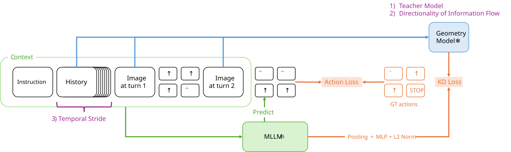

# Front Matter

**Degree:** Thesis for Bachelor's Degree
**Title (EN):** Analyzing Design Factors of Geometry Feature Distillation for MLLM-Based Vision-and-Language Navigation
**Title (KO):** MLLM 기반 Vision-and-Language Navigation을 위한 Geometry Feature Distillation의 설계 요인 분석
**Author:** Janghan Noh (노장한)
**Student ID / Code:** B.S./EC 20235059
**Department:** Department of Electrical Engineering and Computer Science, College of Artificial Intelligence
**Institution:** Gwangju Institute of Science and Technology
**Location:** Gwangju, Republic of Korea
**Year:** 2026
**Approval Date:** December 4, 2026
**Total Pages:** <!-- TODO: 최종 컴파일 후 페이지 수 기입 -->  
**Advisor:** Professor Ue-Hwan Kim
**Committee Chair:** Prof. Ue-Hwan Kim
**Committee Members:** Prof. Pyojin Kim

---

# Abstract

Multimodal Large Language Models (MLLMs) show strong generalization in Vision-and-Language Navigation, yet their 2D-centric visual encoders struggle with 3D spatial reasoning. Training-time feature distillation from pretrained geometry foundation models injects 3D priors without inference overhead, but the design conditions for effective transfer remain unexamined.

This thesis evaluates three design factors of geometry feature distillation on VLN-CE: (1) teacher selection across feed-forward and recurrent models, (2) information flow directionality comparing bidirectional and causal teachers, and (3) temporal stride of navigation history. Results reveal three findings. First, under standard final-layer distillation, Pi3, which decodes geometry directly from its final layers, substantially outperforms the non-distilled baseline, whereas DPT-based models yield marginal gains or negative transfer, highlighting alignment between decoding heads and distillation targets. Second, bidirectional and causal variants exhibit no consistent advantage, indicating that attention directionality is not a primary bottleneck. Third, wider temporal strides improve overall performance through longer history, while distillation gains narrow at wider strides due to reduced visual overlap. Overall, target representation alignment and temporal context outweigh attention directionality, motivating multi-layer distillation for DPT-based teachers and decoupled stride designs.

---

# I. INTRODUCTION

Vision-and-Language Navigation (VLN) requires an agent to navigate an unseen 3D environment to reach a target location by following natural language instructions and real-time egocentric visual observations. With their strong vision-language reasoning and generalization capabilities, Multimodal Large Language Models (MLLMs) have emerged as the core architecture for VLN agents, where the ability to infer 3D physical structure from 2D RGB observations is critical to navigation success and efficiency. However, the visual encoders of existing MLLMs suffer from fundamental limitations in 3D spatial reasoning. Feature distillation, which transfers representations from pretrained geometry models into MLLM visual tokens, has gained attention as a promising remedy. Nevertheless, prior studies rely on a single teacher model and a fixed distillation pipeline, leaving the key design conditions for effectively transferring 3D geometric priors to VLN MLLMs systematically unexamined.

To bridge this gap, this study decomposes the impact of geometry-based feature distillation on MLLM navigation performance along three design axes. First, we investigate teacher model selection. Recently proposed feed-forward models and the recurrent model differ markedly in their backbone architectures and 3D decoding mechanisms, raising the question of which geometry model serves as the most effective distillation target for VLN. Second, we examine information flow directionality. Whereas multi-view geometry models attend bidirectionally across all frames to capture cross-view consistency, MLLM decoders enforce a unidirectional information flow via causal attention. By comparing bidirectional and causal variants of the VGGT family and CUT3R, we analyze how this directional mismatch between teacher and student affects distillation performance. Third, we study the temporal stride used to construct the navigation context. Unlike standard 2D encoders that process images independently, multi-view geometry models jointly encode multiple frames; accordingly, we evaluate how changes in inter-frame visual overlap induced by the history sampling interval affect teacher feature quality and downstream VLN performance.

Our systematic analysis yields three key findings. First, under standard final-layer feature distillation, Pi3 which decodes geometry directly from its terminal backbone outputs without multi-layer aggregation achieves substantial performance gains, whereas DPT-head-based models yield only marginal improvements or degrade nDTW on RxR-CE. This indicates that structural alignment between the teacher's decoding head and the distillation target layer is a critical design factor. Second, neither bidirectional nor causal variants exhibit a consistent advantage across the VGGT and CUT3R families, demonstrating that information flow directionality mismatch is not a dominant bottleneck in the current VLN feature distillation pipeline. Third, widening the temporal stride of navigation history improves overall performance by providing longer-term context, yet progressively narrows the additional gains from distillation. This reveals a structural trade-off: while wider strides benefit long-horizon context modeling, they reduce inter-frame visual overlap and weaken the 3D spatial reasoning benefits of multi-view geometry teachers.

---

# II. RELATED WORK

**Vision-and-Language Navigation.** Early VLN research focused on discrete environments where agents traverse predefined navigation graphs, such as R2R [1] and RxR [2], before shifting toward Vision-and-Language Navigation in Continuous Environments (VLN-CE) [3], which predicts low-level actions in continuous 3D spaces to better reflect real-world robotic control. Initial VLN-CE approaches relied on cross-modal policies driven by RGB-D and odometry inputs [3], waypoint predictors pretrained in simulators [4], or explicit semantic maps and 3D feature fields [5, 6].

Recent work has leveraged the generalization capabilities of LLMs and MLLMs to overcome these constraints. Early efforts converted visual observations into text to employ LLMs as zero-shot planners [7, 8], but suffered from severe spatial information loss and high inference latency. NaVid [9] subsequently established a video-based VLM paradigm that predicts low-level actions end-to-end solely from monocular RGB video without maps, odometry, or depth. Follow-up studies extended this paradigm toward unifying diverse embodied navigation tasks within a single MLLM [10-13], while StreamVLN [14] achieved low-latency inference over long horizons by combining a sliding-window KV cache with slow-updating memory in a multi-turn dialogue framework. However, because existing MLLM visual encoders are pretrained primarily on 2D image-text pairs, they remain weak at 3D geometric reasoning. To address this limitation, JanusVLN [15] introduced a dual implicit memory architecture that maintains separate initial-window and sliding-window KV caches for an MLLM's 2D semantic encoder and a VGGT-based 3D spatial geometry encoder. Although this substantially improves RGB-only VLN-CE performance, it retains the memory and computational overhead of continuously running an auxiliary geometry encoder at inference time.

**Geometry Models.** Reconstructing 3D structure from single or multiple RGB images was traditionally formulated as iterative optimization within multi-stage Structure-from-Motion (SfM) [16] and Multi-View Stereo (MVS) [17] pipelines. Due to their high computational cost and fragile correspondence matching, the field has shifted toward end-to-end learning-based models. DUSt3R [18] and its follow-ups [19, 20] marked a turning point by directly regressing 3D pointmaps from image pairs in a feed-forward manner without camera parameters, though scaling to multiple views still required offline global alignment. More recently, multi-view feed-forward geometry foundation models [21-24] have enabled single-pass prediction of camera poses and dense 3D geometry from an arbitrary number of images without global alignment, progressing toward permutation-equivariant designs that remove fixed reference-view dependencies and unified representations built on a single plain transformer [23, 24].

Because these multi-view feed-forward models perform bidirectional global attention across all input frames, streaming scenarios require recomputing the entire sequence at each timestep and allow future frame information to leak into current representations. Consequently, recent research has explored online 3D perception for incremental streaming inputs, exemplified by recurrent architectures that update spatial memory and persistent states [25, 26] and StreamVGGT [27], which replaces global attention with temporal causal attention. Although modern geometry models differ substantially in backbone design, decoding layers, and information flow directionality, how these architectural properties govern VLN distillation efficacy remains largely unexplored.

**Spatial Knowledge Distillation.** To enhance MLLM spatial perception without dedicated 3D sensors, several studies directly fuse features from pretrained geometry encoders at inference time [15, 28, 29], which inevitably incurs external-encoder memory and latency overhead. To eliminate this deployment cost, training-time spatial knowledge distillation based on intermediate representation supervision [30] has emerged as an attractive alternative. Aligning frozen geometry teacher features with MLLM visual tokens has expanded from general spatial reasoning [31, 32] and robotic manipulation VLAs [33] to VLN-CE in recent works such as StageVLN [34] and GuidedNav [35]. However, existing VLN distillation methods predominantly rely on a single VGGT-family teacher and a fixed distillation setup, leaving the impacts of teacher backbone selection, bidirectional-to-causal directional mismatch, and navigation history stride unexamined.

---

# III. ANALYSIS FRAMEWORK

This section defines our analytical framework for evaluating how geometry-model-based feature distillation affects MLLM performance on VLN. Specifically, we systematically investigate the effects of teacher model architecture, information flow directionality, and the temporal stride of navigation history on distillation efficacy and navigation performance.

## 3.1 MLLM Baseline

In VLN, an agent predicts the next action $a_{t+1}$ conditioned on a natural language instruction $I$ and the sequence of RGB observations up to timestep $t$, $\mathcal{O}_t = \{x_1, \dots, x_t\}$. The action space consists of `MOVE_FORWARD`, `TURN_LEFT`, `TURN_RIGHT`, and `STOP`, and the agent's policy is formulated as:

$$
a_{t+1} \sim \pi(\cdot \mid \mathcal{O}_t, I)
$$

Our baseline is an MLLM adapted to VLN via supervised fine-tuning (SFT). The agent operates in a multi-turn dialogue format, predicting 4 consecutive actions per turn. After executing every 4 actions, a new observation image is appended to the dialogue; once 8 turns of predictions are completed, the context is reset and a new dialogue begins. Each dialogue is initialized with the natural language instruction $I$ and a navigation history consisting of the preceding 8 observation images sampled at 4-step intervals.

## 3.2 Teacher Models

**VGGT [22]** is a feed-forward transformer that jointly predicts camera parameters, depth maps, pointmaps, and 3D point tracks from single or multiple RGB images in a forward pass. Each input image is tokenized into patches via DINOv2 [36] and augmented with learnable camera and register tokens. The resulting sequence passes through an Alternating-Attention backbone that interleaves frame-wise self-attention with bidirectional global self-attention across all frames. A camera head then estimates camera intrinsics and extrinsics from the camera tokens, while a DPT head [37] aggregates intermediate features from multiple backbone layers for dense predictions, including depth maps and viewpoint-invariant pointmaps.

**Pi3 [23]** is a permutation-equivariant visual geometry model designed to eliminate the input-order sensitivity and inductive bias introduced by anchoring coordinates to a fixed reference view. Like VGGT, it tokenizes images using DINOv2, but removes order-dependent components and exchanges multi-view information across 36 layers of alternating view-wise and global self-attention initialized from VGGT weights. Rather than employing a DPT head that fuses multi-layer intermediate features, Pi3 applies a lightweight transformer decoder that independently processes final-layer backbone features per view, followed by MLP and pixel-shuffle output heads. This enables the prediction of scale-invariant local pointmaps in each frame's own coordinate system without a global reference frame, alongside affine-invariant camera poses supervised by relative poses.

**DepthAnything3 (DA3) [24]** unifies monocular and any-view 3D geometry reconstruction using a single plain transformer and a depth-ray representation, avoiding specialized architectures and redundant multi-task targets. It adopts a pretrained vanilla DINOv2 backbone without structural modifications. Within the transformer backbone, early layers perform only within-view self-attention, whereas later layers alternate between cross-view self-attention (via token rearrangement) and within-view self-attention. For output decoding, a Dual-DPT head [37] processes multi-layer backbone features through a shared reassembly module and separate fusion branches to jointly predict dense depth maps and per-pixel ray maps.

**CUT3R [26]** is a stateful recurrent 3D perception model that processes image sequences sequentially while continuously updating a persistent state. Each frame passes through a shared ViT [38] encoder initialized with DUSt3R [18] weights and a ViT-Base transformer decoder. At every timestep, the model simultaneously performs a state-update to integrate the current observation into the persistent state and a state-readout to inject past 3D context into the image tokens. From the post-decoder image and pose tokens, it predicts metric-scale pointmaps in both local and world frames via a DPT head [37] and 6-DoF ego-motion via an MLP head. While CUT3R defaults to unidirectional online inference conditioned only on past and current observations, it also supports bidirectional global context through a revisiting mode, which accumulates and fixes the final state over a first pass before re-encoding the same sequence.

## 3.3 Directionality of Information Flow

Most multi-view geometry models rely on bidirectional information exchange when encoding image sequences. By contrast, a student MLLM's causal attention permits only unidirectional information flow, potentially making it difficult for the student to predict teacher target features that encode future frame information. To investigate how teacher encoding directionality affects target feature quality and VLN performance, we construct controlled comparisons across two model families.

**VGGT Variants.** VGGT incorporates future frame context into current frame representations via bidirectional global attention. We compare it against two causal variants. First, causal VGGT retains the pretrained VGGT weights unchanged while applying a causal mask solely to the bidirectional global attention layers. Second, to control for potential representation degradation caused by the mismatch between bidirectional pretraining and inference-time causal masking, we evaluate StreamVGGT [27], which is trained directly with temporal causal attention.

**CUT3R Variants.** CUT3R performs sequential inference via its recurrent architecture and can incorporate bidirectional global context through revisiting mode, which accumulates hidden states in a first unidirectional pass and re-encodes the sequence in a second pass. We compare bidirectional inference (with revisiting) against unidirectional inference (without revisiting) to assess the role of information flow directionality in recurrent teachers.

## 3.4 Temporal Stride in Context

Because multi-view geometry models infer 3D structure from cross-frame visual correspondences, they are sensitive to the temporal spacing between context frames. In our default configuration, the navigation history samples the preceding 8 images at 4-step intervals. To examine the interplay between long-horizon context acquisition and 3D spatial reasoning, we vary the temporal stride of the navigation history fed to both the teacher model and the student MLLM across 1, 2, 4, and 8 steps.

## 3.5 Feature Alignment and Distillation Objective

Feature distillation supervises the student MLLM's visual token features using representations extracted from a frozen teacher backbone. For feed-forward teachers (VGGT, Pi3, and DA3), we concatenate the outputs of the last two backbone layers as target features; for the recurrent teacher (CUT3R), we use the post-decoder image tokens. On the student side, visual token features are extracted from the 24th layer of the LLM decoder to compute the knowledge distillation (KD) loss.

Because teacher target features and student visual tokens may differ in spatial resolution and channel dimensionality, we apply average pooling to match patch resolution and a 2-layer MLP ($\operatorname{MLP}_{\text{align}}$) to align channel dimensions. Following 3DRS [31], we apply L2 normalization to both the aligned student feature $\mathbf{f}$ and the teacher target feature $\mathbf{r}$ before computing the Smooth L1 loss. The overall training objective is defined as:

$$
\mathcal{L}_{KD} = \operatorname{SmoothL1}\!\left(\frac{\operatorname{MLP}_{\text{align}}(\mathbf{f})}{\|\operatorname{MLP}_{\text{align}}(\mathbf{f})\|_2},\ \frac{\mathbf{r}}{\|\mathbf{r}\|_2}\right)
$$

$$
\mathcal{L} = \mathcal{L}_{act} + \lambda \mathcal{L}_{KD}
$$

where $\mathcal{L}_{act}$ is the SFT loss for MLLM action prediction and $\lambda$ controls the weight of the KD loss. Figure 1 illustrates the overall framework and the three design factors.

**Figure 1.** Overview of the geometry feature distillation framework for MLLM-based VLN and the three design factors analyzed in this study: (1) teacher model selection, (2) information flow directionality, and (3) temporal stride of navigation history.

---

# IV. EXPERIMENTS

This section presents our experimental setup and analyzes the VLN-CE benchmark results along the three design axes. Section 4.1 details the training and evaluation protocols, followed by our analyses of teacher model selection (Section 4.2), information flow directionality (Section 4.3), and temporal stride of navigation history (Section 4.4).

## 4.1 Experimental Setup

**Training Setup.** All models were trained exclusively on the R2R and RxR training splits without external data. We performed rank-64 LoRA fine-tuning across the entire MLLM excluding the visual encoder. Key training hyperparameters are summarized in Table 1.

| Item | Setting |
| :--- | :--- |
| MLLM | Qwen3-VL-4B-Instruct |
| LoRA hyperparameters | Rank 64, alpha 128, dropout 0.05 |
| Optimizer | AdamW |
| Peak learning rate | $2 \times 10^{-4}$ |
| Weight decay | 0 |
| Learning rate schedule | 2% linear warmup followed by cosine decay |
| Gradient clipping | 1.0 |
| Training duration | 1 epoch, 1,481 optimizer updates |
| GPUs | 8 NVIDIA A30 and 4 NVIDIA H100 configurations |
| Effective batch size | 64 |
| KD loss weight ($\lambda$) | 0.3 |

**Table 1.** Training Hyperparameters

**Datasets and Evaluation.** All evaluations were conducted on R2R-CE and RxR-CE, continuous-environment VLN benchmarks built on the Habitat simulator. R2R-CE features relatively short-horizon navigation tasks, whereas RxR-CE evaluates longer trajectories accompanied by more complex instructions.

We report four primary metrics: Success Rate (SR), Success weighted by Path Length (SPL), Oracle Success Rate (OSR), and Navigation Error (NE). SR measures the fraction of episodes in which the agent stops within the target radius, while SPL accounts for both navigation success and path efficiency. OSR denotes the fraction of episodes in which the agent enters the target radius at any point along its trajectory, and NE measures the shortest distance from the final stopping position to the goal. On RxR-CE, where path fidelity is essential, we additionally report normalized Dynamic Time Warping (nDTW) to evaluate alignment between the agent's trajectory and the ground-truth path.

## 4.2 Impact of Teacher Model

| Teacher Model | SR (%) $\uparrow$ | SPL (%) $\uparrow$ | OSR (%) $\uparrow$ | NE (m) $\downarrow$ |
| :--- | :---: | :---: | :---: | :---: |
| Baseline (No teacher) | 36.43 | 31.40 | 48.18 | 7.40 |
| VGGT | 36.81 | 31.99 | 48.56 | 7.44 |
| Pi3 | **41.49** | **36.45** | **54.92** | **6.54** |
| DA3 | 37.36 | 31.90 | 49.86 | 7.14 |
| CUT3R | 37.25 | 31.87 | 49.32 | 7.37 |

**Table 2.** VLN Performance by Teacher Models on R2R-CE Benchmark

| Teacher Model | SR (%) $\uparrow$ | SPL (%) $\uparrow$ | OSR (%) $\uparrow$ | NE (m) $\downarrow$ | nDTW (%) $\uparrow$ |
| :--- | :---: | :---: | :---: | :---: | :---: |
| Baseline (No teacher) | 42.93 | 34.28 | 56.12 | 7.48 | 53.36 |
| VGGT | 43.01 | 34.39 | 55.82 | 7.52 | 53.00 |
| Pi3 | **44.81** | **36.24** | **57.51** | **7.43** | **53.87** |
| DA3 | 42.41 | 33.66 | 55.63 | 7.67 | 52.30 |
| CUT3R | 42.93 | 34.17 | 55.36 | 7.78 | 52.19 |

**Table 3.** VLN Performance by Teacher Models on RxR-CE Benchmark

Tables 2 and 3 compare R2R-CE and RxR-CE performance across different teacher models under the same feature distillation pipeline. On R2R-CE, distilling from Pi3 yields the largest gains across every metric over the non-distilled baseline, improving SR by 5.06 percentage points and SPL by 5.05 percentage points. On RxR-CE as well, Pi3 outperforms the baseline on all metrics, raising nDTW by 0.51 percentage points. By contrast, distilling from VGGT, DA3, or CUT3R produces only marginal improvements on R2R-CE and degrades nDTW below the baseline on RxR-CE.

This disparity likely stems from the degree of alignment between each teacher's prediction head and the distillation target location. Because Pi3 performs dense prediction directly from the outputs of its last two backbone blocks, it is structurally well-matched to the standard distillation objective that supervises late-layer features. Conversely, VGGT, DA3, and CUT3R are trained to decode geometry through a DPT head that aggregates features across multiple intermediate layers. Consequently, 3D geometric cues may not be sufficiently concentrated in the terminal backbone layers alone, implying that conventional final-layer distillation fails to fully harness the representational capacity of DPT-head-based teachers.

## 4.3 Impact of Information Flow Directionality

| Family | Teacher | Directionality | SR (%) $\uparrow$ | SPL (%) $\uparrow$ | OSR (%) $\uparrow$ | NE (m) $\downarrow$ |
| :--- | :--- | :--- | :---: | :---: | :---: | :---: |
| VGGT | VGGT | Bidirectional | 36.81 | 31.99 | 48.56 | 7.44 |
| VGGT | Causal VGGT | Causal, mask-only | **36.87** | **32.05** | **49.05** | **7.40** |
| VGGT | StreamVGGT | Causal, trained | 35.51 | 30.22 | 46.82 | 7.63 |
| CUT3R | CUT3R revisiting | Bidirectional | 36.05 | 31.36 | 49.10 | **7.37** |
| CUT3R | CUT3R | Causal, recurrent | **37.25** | **31.87** | **49.32** | **7.37** |

**Table 4.** R2R-CE Performance by Information Flow Directionality

| Family | Teacher | Directionality | SR (%) $\uparrow$ | SPL (%) $\uparrow$ | OSR (%) $\uparrow$ | NE (m) $\downarrow$ | nDTW (%) $\uparrow$ |
| :--- | :--- | :--- | :---: | :---: | :---: | :---: | :---: |
| VGGT | VGGT | Bidirectional | **43.01** | **34.39** | **55.82** | **7.52** | **53.00** |
| VGGT | Causal VGGT | Causal, mask-only | 41.48 | 33.12 | 54.75 | 7.88 | 51.60 |
| VGGT | StreamVGGT | Causal, trained | 42.49 | 34.15 | 55.27 | 7.79 | 52.75 |
| CUT3R | CUT3R revisiting | Bidirectional | 41.59 | 33.48 | 54.65 | **7.74** | **52.92** |
| CUT3R | CUT3R | Causal, recurrent | **42.93** | **34.17** | **55.36** | 7.78 | 52.19 |

**Table 5.** RxR-CE Performance by Information Flow Directionality

Tables 4 and 5 compare VLN-CE performance across information flow directionalities within the VGGT and CUT3R families. On R2R-CE, causal VGGT and unidirectional CUT3R achieve slightly higher SR than their respective bidirectional counterparts. However, StreamVGGT attains only 35.51% SR and 30.22% SPL, underperforming both standard VGGT and causal VGGT.

On the longer-horizon RxR-CE benchmark, causal VGGT suffers a pronounced performance drop relative to VGGT, whereas StreamVGGT recovers much of this gap, reaching 42.49% SR and 52.75% nDTW. This confirms that causal training mitigates the distribution mismatch induced by applying an inference-time causal mask to a bidirectionally pretrained model. Even so, StreamVGGT still falls short of bidirectional VGGT across all metrics, and the CUT3R family shows mixed trends, with unidirectional CUT3R leading in SR and SPL while bidirectional CUT3R revisiting leads in nDTW.

Overall, introducing a causally trained teacher does not yield a consistent advantage over bidirectional teachers, and relative performance varies across benchmarks and metrics. These results indicate that the directional mismatch between teacher and student attention is not a dominant bottleneck in the current VLN feature distillation pipeline.

## 4.4 Impact of Temporal Stride

**Figure 2.** RxR-CE nDTW (%) across temporal strides of history

We next examine how varying the temporal stride (sampling interval) affects performance while holding the number of past frames in the navigation history fixed at 8. Figure 2 plots RxR-CE nDTW for both the baseline and the Pi3-distilled model across strides of 1, 2, 4, and 8. Both models achieve steadily higher overall nDTW as the stride widens.

However, the marginal gain from distillation varies non-monotonically with stride. At stride 1, viewpoint changes between adjacent frames are minimal, providing insufficient parallax for 3D geometry inference; consequently, the gain from Pi3 distillation is smaller than at stride 2. As the stride increases from 2 to 4 and 8, the gap between the two models progressively narrows, indicating that the added benefit of geometry distillation diminishes in wide-stride regimes.

This pattern reflects a structural trade-off inherent to expanding the temporal stride. A wider stride enables a fixed frame budget to span a longer navigation history, improving the MLLM's long-horizon context comprehension. At the same time, inter-frame visual overlap drops sharply, impairing the multi-view geometry teacher's ability to establish cross-frame spatial correspondences and degrading the quality of its target features.

---

# V. DISCUSSION

This section synthesizes our empirical findings to discuss the primary design factors governing geometry-based feature distillation (Section 5.1), followed by limitations and directions for future work (Section 5.2).

## 5.1 Design Factors

Our results across the three design axes indicate that target representation structure and context stride play a far more decisive role in VLN spatial knowledge distillation than information flow directionality.

First, teacher selection and target layer placement are critical. Our experiments show that Pi3 substantially outperforms all other geometry teachers. This may be because, unlike DPT-head-based models that aggregate features across multiple intermediate layers, Pi3 predicts geometry directly from its final backbone layers. Consequently, the conventional practice of uniformly distilling only final-layer features can be suboptimal depending on the teacher's decoding architecture.

Second, the directional mismatch between bidirectional teachers and causal MLLMs does not produce consistent performance differences. Although causally trained StreamVGGT substantially mitigates the degradation of mask-only causal VGGT on RxR-CE, it still fails to surpass bidirectional VGGT, and the CUT3R variants exhibit mixed superiority across metrics. Thus, neither future-frame leakage nor attention directionality acts as a primary bottleneck in the current distillation pipeline.

Third, our temporal stride analysis uncovers a structural trade-off between long-horizon navigation learning and geometry distillation. While wider strides improve both the baseline and distilled MLLMs by exposing longer navigation histories, overly narrow strides limit distillation gains due to insufficient parallax, and overly wide strides reduce inter-frame visual overlap, degrading the multi-view teacher's spatial inference and target feature quality. As a result, a single coupled stride configuration cannot simultaneously maximize long-term context retention and fine-grained 3D spatial supervision.

## 5.2 Limitation & Future Work

This study evaluated a limited set of teacher models and employed LoRA for parameter-efficient fine-tuning. Expanding the analysis to a broader suite of geometry foundation models and evaluation benchmarks will be important to verify the generality of our findings. Moreover, investigating whether full fine-tuning allows the student MLLM to absorb high-dimensional geometric representations with greater capacity than LoRA could reveal further distillation gains.

Disentangling architectural factors also remains an open challenge. Although we attribute Pi3's advantage to the alignment between its prediction head and the final-layer distillation target, fixing the target to the last two layers prevents us from fully isolating this effect from other Pi3-specific properties, such as its permutation-equivariant design. Future ablation studies that extract distillation targets from the actual intermediate input layers of DPT-based teachers (e.g., VGGT and DA3) are needed to test this hypothesis directly.

Finally, resolving the temporal stride trade-off calls for architectural improvements to the distillation pipeline. Under the current coupled-stride setup, the MLLM and geometry teacher share identically sampled frames, placing long-horizon context and inter-frame visual overlap in direct conflict. A promising direction for future work is a decoupled-stride distillation framework, in which the MLLM observes a wide-stride history for long-term context while the geometry teacher processes denser-stride frames to produce high-quality 3D target features.
---

# SUMMARY

**Analyzing Design Factors of Geometry Feature Distillation for MLLM-Based Vision-and-Language Navigation**

This thesis systematically analyzes the key design factors of geometry-model-based feature distillation, which enhances the 3D spatial perception of Multimodal Large Language Models (MLLMs) without incurring additional memory or computational overhead at inference time. Across the R2R-CE and RxR-CE benchmarks, we evaluate how teacher model selection, information flow directionality, and the temporal stride of navigation history affect Vision-and-Language Navigation (VLN) performance. Our findings demonstrate that: (1) alignment between the teacher model's geometry decoding architecture and the distillation target layer strongly impacts performance; (2) the information flow directionality mismatch between bidirectional and causal teachers is not a dominant bottleneck in the current pipeline; and (3) a wider context stride helps the MLLM capture longer-horizon navigation context, but reduces inter-frame visual overlap and diminishes 3D spatial reasoning gains, creating a structural trade-off.

Future work should more rigorously validate these factors and incorporate them into improved distillation designs. Specifically, multi-layer distillation, which incorporates intermediate layers into the distillation target when using DPT-head-based teachers, and a decoupled stride design that separates the MLLM's long-horizon context retention from the geometry teacher's high-quality 3D representation generation represent promising directions for improvement.

---

# REFERENCES

[1] P. Anderson, Q. Wu, D. Teney, J. Bruce, M. Johnson, N. Sünderhauf, I. Reid, S. Gould, and A. van den Hengel, "Vision-and-Language Navigation: Interpreting Visually-Grounded Navigation Instructions in Real Environments," in *Proc. IEEE/CVF Conf. Comput. Vis. Pattern Recognit. (CVPR)*, 2018.

[2] A. Ku, P. Anderson, R. Patel, E. Ie, and J. Baldridge, "Room-Across-Room: Multilingual Vision-and-Language Navigation with Dense Spatiotemporal Grounding," in *Proc. Conf. Empir. Methods Nat. Lang. Process. (EMNLP)*, 2020.

[3] J. Krantz, E. Wijmans, A. Majumdar, D. Batra, and S. Lee, "Beyond the Nav-Graph: Vision-and-Language Navigation in Continuous Environments," in *Proc. Eur. Conf. Comput. Vis. (ECCV)*, 2020.

[4] D. An, H. Wang, W. Wang, Z. Wang, Y. Huang, K. He, and L. Wang, "ETPNav: Evolving Topological Planning for Vision-Language Navigation in Continuous Environments," *arXiv preprint arXiv:2304.03047*, 2023.

[5] Z. Wang, X. Li, J. Yang, Y. Liu, and S. Jiang, "GridMM: Grid Memory Map for Vision-and-Language Navigation," in *Proc. IEEE/CVF Int. Conf. Comput. Vis. (ICCV)*, 2023.

[6] Z. Wang and G. H. Lee, "g3D-LF: Generalizable 3D-Language Feature Fields for Embodied Tasks," in *Proc. IEEE/CVF Conf. Comput. Vis. Pattern Recognit. (CVPR)*, 2025.

[7] G. Zhou, Y. Hong, and Q. Wu, "NavGPT: Explicit Reasoning in Vision-and-Language Navigation with Large Language Models," *arXiv preprint arXiv:2305.16986*, 2023.

[8] Y. Long, W. Cai, H. Wang, G. Zhan, and H. Dong, "InstructNav: Zero-shot System for Generic Instruction Navigation in Unexplored Environment," in *Proc. Conf. Robot Learn. (CoRL)*, 2024.

[9] J. Zhang, K. Wang, R. Xu, G. Zhou, Y. Hong, X. Fang, Q. Wu, Z. Zhang, and H. Wang, "NaVid: Video-based VLM Plans the Next Step for Vision-and-Language Navigation," in *Proc. Robot.: Sci. Syst. (RSS)*, 2024.

[10] J. Zhang, K. Wang, S. Wang, M. Li, H. Liu, S. Wei, Z. Wang, Z. Zhang, and H. Wang, "Uni-NaVid: A Video-based Vision-Language-Action Model for Unifying Embodied Navigation Tasks," in *Proc. Robot.: Sci. Syst. (RSS)*, 2025.

[11] A.-C. Cheng, Y. Ji, Z. Yang, Z. Gongye, X. Zou, J. Kautz, E. Bıyık, H. Yin, S. Liu, and X. Wang, "NaVILA: Legged Robot Vision-Language-Action Model for Navigation," in *Proc. Robot.: Sci. Syst. (RSS)*, 2025.

[12] C. Gao, L. Jin, X. Peng, J. Zhang, Y. Deng, A. Li, H. Wang, and S. Liu, "OctoNav: Towards Generalist Embodied Navigation," in *Proc. IEEE/CVF Conf. Comput. Vis. Pattern Recognit. (CVPR)*, 2026.

[13] Qwen Team, "Qwen-RobotNav Technical Report: A Scalable Navigation Model Designed for an Agentic Navigation System," *arXiv preprint arXiv:2606.18112*, 2026.

[14] M. Wei, C. Wan, X. Yu, T. Wang, Y. Yang, X. Mao, C. Zhu, W. Cai, H. Wang, Y. Chen, X. Liu, and J. Pang, "StreamVLN: Streaming Vision-and-Language Navigation via SlowFast Context Modeling," *arXiv preprint arXiv:2507.05240*, 2026.

[15] S. Zeng, D. Qi, X. Chang, F. Xiong, S. Xie, X. Wu, S. Liang, M. Xu, X. Wei, and N. Guo, "JanusVLN: Decoupling Semantics and Spatiality with Dual Implicit Memory for Vision-Language Navigation," in *Proc. Int. Conf. Learn. Represent. (ICLR)*, 2026.

[16] J. L. Schönberger and J.-M. Frahm, "Structure-from-Motion Revisited," in *Proc. IEEE/CVF Conf. Comput. Vis. Pattern Recognit. (CVPR)*, 2016.

[17] Y. Furukawa and C. Hernández, "Multi-View Stereo: A Tutorial," *Found. Trends Comput. Graph. Vis.*, vol. 9, no. 1–2, pp. 1–148, 2015.

[18] S. Wang, V. Leroy, Y. Cabon, B. Chidlovskii, and J. Revaud, "DUSt3R: Geometric 3D Vision Made Easy," in *Proc. IEEE/CVF Conf. Comput. Vis. Pattern Recognit. (CVPR)*, 2024.

[19] V. Leroy, Y. Cabon, and J. Revaud, "Grounding Image Matching in 3D with MASt3R," in *Proc. Eur. Conf. Comput. Vis. (ECCV)*, 2024.

[20] J. Zhang, C. Herrmann, J. Hur, V. Jampani, T. Darrell, F. Cole, D. Sun, and M.-H. Yang, "MonST3R: A Simple Approach for Estimating Geometry in the Presence of Motion," in *Proc. Int. Conf. Learn. Represent. (ICLR)*, 2025.

[21] J. Yang, A. Sax, K. J. Liang, M. Henaff, H. Tang, A. Cao, J. Chai, F. Meier, and M. Feiszli, "Fast3R: Towards 3D Reconstruction of 1000+ Images in One Forward Pass," in *Proc. IEEE/CVF Conf. Comput. Vis. Pattern Recognit. (CVPR)*, 2025.

[22] J. Wang, M. Chen, N. Karaev, A. Vedaldi, C. Rupprecht, and D. Novotny, "VGGT: Visual Geometry Grounded Transformer," in *Proc. IEEE/CVF Conf. Comput. Vis. Pattern Recognit. (CVPR)*, 2025.

[23] Y. Wang, J. Zhou, H. Zhu, W. Chang, Y. Zhou, Z. Li, J. Chen, J. Pang, C. Shen, and T. He, "$\pi^3$: Permutation-Equivariant Visual Geometry Learning," in *Proc. Int. Conf. Learn. Represent. (ICLR)*, 2026.

[24] H. Lin, S. Chen, J. H. Liew, D. Y. Chen, Z. Li, G. Shi, J. Feng, and B. Kang, "Depth Anything 3: Recovering the Visual Space from Any Views," *arXiv preprint arXiv:2511.10647*, 2025.

[25] H. Wang and L. Agapito, "3D Reconstruction with Spatial Memory," *arXiv preprint arXiv:2408.16061*, 2024.

[26] Q. Wang, Y. Zhang, A. Holynski, A. A. Efros, and A. Kanazawa, "Continuous 3D Perception Model with Persistent State," in *Proc. IEEE/CVF Conf. Comput. Vis. Pattern Recognit. (CVPR)*, 2025.

[27] D. Zhuo, W. Zheng, J. Guo, Y. Wu, J. Zhou, and J. Lu, "StreamVGGT: Streaming 4D Visual Geometry Transformer," in *Proc. Int. Conf. Learn. Represent. (ICLR)*, 2026.

[28] D. Wu, F. Liu, Y.-H. Hung, and Y. Duan, "Spatial-MLLM: Boosting MLLM Capabilities in Visual-based Spatial Intelligence," *arXiv preprint arXiv:2505.23747*, 2025.

[29] D. Zheng, S. Huang, Y. Li, and L. Wang, "Learning from Videos for 3D World: Enhancing MLLMs with 3D Vision Geometry Priors," *arXiv preprint arXiv:2505.24625*, 2025.

[30] A. Romero, N. Ballas, S. E. Kahou, A. Chassang, C. Gatta, and Y. Bengio, "FitNets: Hints for Thin Deep Nets," in *Proc. Int. Conf. Learn. Represent. (ICLR)*, 2015.

[31] X. Huang, J. Wu, Q. Xie, and K. Han, "3DRS: MLLMs Need 3D-Aware Representation Supervision for Scene Understanding," in *Adv. Neural Inf. Process. Syst. (NeurIPS)*, 2025.

[32] X. Huang, Y. Guo, and K. Han, "What Makes a Good Visual Representation for Spatial Understanding in MLLMs?," *arXiv preprint arXiv:2610.17844*, 2026.

[33] F. Li, W. Song, H. Zhao, J. Wang, P. Ding, D. Wang, L. Zeng, and H. Li, "Spatial Forcing: Implicit Spatial Representation Alignment for Vision-Language-Action Model," in *Proc. Int. Conf. Learn. Represent. (ICLR)*, 2026.

[34] A. Dao, Q.-D. Pham, L. D. Vinh, T. A. Nguyen, N. V. T. Pham, Y. Chen, P. T. Le, V.-T. Nguyen, and Q. Nguyen, "StageVLN: Spatial and Trajectory Auxiliary Guidance for Efficient Vision-Language Navigation," *arXiv preprint arXiv:2610.05664*, 2026.

[35] J. Guo, J. Huang, C. Lin, X. Luo, C. Wen, S. Ye, T. Chu, S. Huang, and M. Gong, "GuidedNav: Shaping Vision-Language Navigation Representations through Pre-Action Attention and Spatial Guidance," *arXiv preprint arXiv:2610.13122*, 2026.

[36] M. Oquab, T. Darcet, T. Moutakanni, H. Vo, M. Szafraniec, V. Khalidov, P. Fernandez, D. Haziza, F. Massa, A. El-Nouby, M. Assran, N. Ballas, W. Galuba, R. Howes, P.-Y. Huang, S.-W. Li, I. Misra, M. Rabbat, V. Sharma, G. Synnaeve, H. Xu, H. Jegou, J. Mairal, P. Labatut, A. Joulin, and P. Bojanowski, "DINOv2: Learning Robust Visual Features without Supervision," *Trans. Mach. Learn. Res. (TMLR)*, 2024.

[37] R. Ranftl, A. Bochkovskiy, and V. Koltun, "Vision Transformers for Dense Prediction," in *Proc. IEEE/CVF Int. Conf. Comput. Vis. (ICCV)*, 2021.

[38] A. Dosovitskiy, L. Beyer, A. Kolesnikov, D. Weissenborn, X. Zhai, T. Unterthiner, M. Dehghani, M. Minderer, G. Heigold, S. Gelly, J. Uszkoreit, and N. Houlsby, "An Image is Worth 16x16 Words: Transformers for Image Recognition at Scale," in *Proc. Int. Conf. Learn. Represent. (ICLR)*, 2021.

---

# ACKNOWLEDGEMENT

---

# CURRICULUM VITAE

**Name:** Janghan Noh (노장한)

**Birth Date:** 2003. 10. 26.

**Birth Place:** Jeonju, Republic of Korea
**Permanent Address:** Gwangju, Republic of Korea

## Education

* 2023.03 - 2027.02: Gwangju Institute of Science and Technology (B.S.)

## Work Experience

## Professional Activities

## Honors and Awards