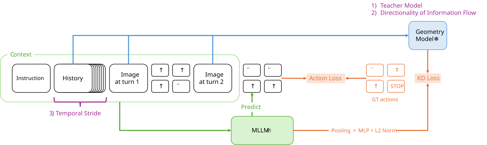
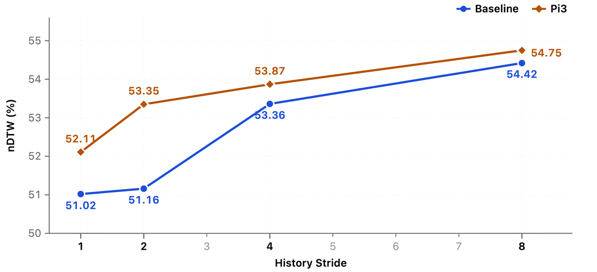

<!-- Metadata & Front Matter: LaTeX 템플릿 매크로에 맞춰 아래 항목을 매핑하세요. -->

# Front Matter

**Degree:** Thesis for Bachelor's Degree  
**Title (EN):** Analyzing Design Factors of Geometry Feature Distillation for MLLM-Based Vision-and-Language Navigation  
**Title (KO):** MLLM 기반 Vision-and-Language Navigation을 위한 Geometry Feature Distillation의 설계 요인 분석  
**Author:** Janghan Noh (노장한)  
**Student ID / Code:** B.S./EC 20235059  
**Department:** Department of Electrical Engineering and Computer Science, College of Artificial Intelligence  
**Institution:** Gwangju Institute of Science and Technology  
**Location:** Gwangju, Republic of Korea  
**Year:** 2026  
**Approval Date:** December 4, 2026  
**Total Pages:** <!-- TODO: 최종 컴파일 후 페이지 수 기입 -->  
**Advisor:** Professor Ue-Hwan Kim  
**Committee Chair:** Prof. Ue-Hwan Kim  
**Committee Members:** Prof. Pyojin Kim  

---

# Abstract

Multimodal Large Language Models (MLLMs) show strong generalization in Vision-and-Language Navigation, yet their 2D-centric visual encoders struggle with 3D spatial reasoning. Training-time feature distillation from pretrained geometry foundation models injects 3D priors without inference overhead, but the design conditions for effective transfer remain unexamined.

This thesis evaluates three design factors of geometry feature distillation on VLN-CE: (1) teacher selection across feed-forward and recurrent models, (2) information flow directionality comparing bidirectional and causal teachers, and (3) temporal stride of navigation history. Results reveal three findings. First, under standard final-layer distillation, Pi3, which decodes geometry directly from its final layers, substantially outperforms the non-distilled baseline, whereas DPT-based models yield marginal gains or negative transfer, highlighting alignment between decoding heads and distillation targets. Second, bidirectional and causal variants exhibit no consistent advantage, indicating that attention directionality is not a primary bottleneck. Third, wider temporal strides improve overall performance through longer history, while distillation gains narrow at wider strides due to reduced visual overlap. Overall, target representation alignment and temporal context outweigh attention directionality, motivating multi-layer distillation for DPT-based teachers and decoupled stride designs.

<!-- Auto-generated by LaTeX: \tableofcontents, \listoftables, \listoffigures -->

---

# I. INTRODUCTION

VLN은 에이전트가 자연어 지시와 실시간으로 갱신되는 1인칭 시각 관찰을 바탕으로 미지의 3D 환경을 탐색하여 목표 지점에 도달하는 과제이다. 이 과정에서 뛰어난 시각-언어 추론 능력과 일반화 성능을 갖춘 MLLM이 VLN 에이전트의 핵심 아키텍처로 자리 잡았으며, 2D RGB 관찰로부터 3D 물리 공간의 구조를 정확히 추론하는 spatial reasoning 능력이 navigation의 성공과 효율성을 좌우하는 핵심 요소로 작용한다. 그러나 기존 MLLM의 visual encoder는 3D 공간 추론에는 근본적인 한계를 보인다. 이를 보완하기 위해 geometry model의 표현을 MLLM의 visual token으로 전이하는 feature distillation 방식이 대안으로 주목받고 있다. 하지만 선행 연구들은 단일 teacher model과 고정된 distillation 파이프라인에 의존하고 있어, 3D 기하학적 사전지식이 VLN MLLM에 효과적으로 전이되기 위한 핵심 설계 조건은 아직 체계적으로 규명되지 않았다.

본 연구는 이러한 공백을 메우기 위해, geometry model 기반 feature distillation이 MLLM의 VLN 성능에 미치는 영향을 세 가지 설계 축으로 분해하여 분석한다. 첫째는 teacher model의 선택이다. 최근 제안된 feed-forward 구조의 VGGT, Pi3, DepthAnything3와 recurrent 구조의 CUT3R은 backbone 아키텍처와 3D 표현 디코딩 방식에서 뚜렷한 차이를 보이므로, 어떤 geometry model이 VLN을 위한 distillation target으로 가장 효과적인지 검증한다. 둘째는 information flow directionality이다. Multi-view geometry model은 시점 간 일관성을 파악하기 위해 전체 프레임을 양방향으로 참조하는 반면, MLLM 디코더는 causal attention을 통해 단방향 정보 흐름을 유지한다. 본 연구는 VGGT 계열과 CUT3R의 bidirectional 및 causal 변형을 비교하여 teacher model과 student MLLM 간의 정보 흐름 방향 불일치가 distillation 성능에 미치는 영향을 분석한다. 셋째는 context를 구성하는 temporal stride이다. 이미지를 독립적으로 처리하는 기존 2D 인코더와 달리 multi-view geometry model은 여러 이미지를 상호 인코딩하므로, navigation history의 샘플링 간격에 따른 프레임 간 visual overlap 변화가 teacher feature의 품질과 VLN 성능에 미치는 영향을 규명한다.

체계적인 분석을 통해서 본 연구는 세 가지 핵심 발견을 도출하였다. 첫째, backbone의 마지막 레이어 feature를 정렬하는 표준 feature distillation 설정에서는 별도의 다중 레이어 집계 없이 말단 출력으로 geometry를 직접 예측하는 Pi3가 뚜렷한 성능 향상을 보인 반면, DPT head 기반 모델들은 제한적인 개선에 그치거나 RxR-CE의 nDTW에서 오히려 성능이 하락하였다. 이는 teacher model의 decoding 구조와 distillation target 위치 간의 정합성이 핵심 설계 요인임을 시사한다. 둘째, VGGT 계열과 CUT3R의 bidirectional 및 causal 변형 간에 일관된 성능 우위가 나타나지 않아, teacher model과 student MLLM 간의 information flow directionality 불일치는 현재 VLN feature distillation 파이프라인의 지배적인 병목이 아님을 확인하였다. 셋째, navigation history의 temporal stride를 넓힐수록 장기 문맥 확보에 따라 모델의 전반적인 성능은 향상되지만, distillation으로 인한 추가 이득은 stride가 커질수록 점차 축소되는 경향을 보였다. 이는 넓은 stride가 장기 navigation history 파악에는 유리하나 프레임 간 visual overlap을 감소시켜 multi-view geometry teacher의 3D 공간 추론 이점을 약화시키는 구조적 trade-off가 존재함을 보여준다.

---

# II. RELATED WORK

**Vision-and-Language Navigation.** 초기 VLN 연구는 R2R [1]과 RxR [2]처럼 사전에 정의된 navigation graph 위를 이동하는 discrete 환경에 집중하였으나, 실제 로봇 제어를 반영하여 연속 3D 공간에서 low-level action을 예측하는 VLN-CE [3]로 전환되었다. 초기 VLN-CE 방법들은 RGB-D와 odometry 입력 기반의 cross-modal policy [3], 시뮬레이터에서 사전학습된 waypoint predictor [4], 또는 명시적인 semantic map과 3D feature field [5, 6]에 의존하였다.

최근 연구는 LLM과 MLLM의 일반화 능력을 활용해 이러한 제약을 극복하는 방향으로 발전하고 있다. 초기에는 시각 관찰을 텍스트로 변환해 LLM을 zero-shot planner로 사용하는 접근 [7, 8]이 제안되었으나 공간 정보 손실과 추론 지연 문제가 두드러졌고, 이후 NaVid [9]가 지도, odometry, depth 없이 monocular RGB video만으로 low-level action을 end-to-end 예측하는 video-based VLM 패러다임을 확립하였다. 이는 단일 MLLM으로 다양한 embodied navigation 과제를 통합하는 방향으로 발전했고 [10-13], StreamVLN [14]은 multi-turn dialogue 형식에 sliding-window KV cache와 slow-updating memory를 도입해 긴 시퀀스에서도 저지연 추론을 달성하였다. 그러나 기존 MLLM의 visual encoder는 주로 2D image-text 사전학습에 기반하므로 3D 기하학적 추론에 취약하다. 이를 해결하기 위해 JanusVLN [15]은 MLLM의 2D semantic encoder와 VGGT 기반 3D spatial geometry encoder의 KV cache를 initial window와 sliding window로 분리 유지하는 dual implicit memory 구조를 제안하여 RGB-only 입력만으로 VLN-CE 성능을 크게 끌어올렸으나, 추론 시점에 별도의 geometry encoder를 상시 구동해야 하는 메모리 및 연산 오버헤드가 남는다.

**Geometry Models.** 단일 또는 다중 RGB 이미지로부터 3D 구조를 복원하는 문제는 전통적으로 다단계 SfM [16]과 MVS [17] 파이프라인의 반복적 최적화로 접근되었으나, 높은 연산 비용과 취약한 대응점 탐색으로 인해 end-to-end 학습 기반 모델로 패러다임이 이동하였다. DUSt3R [18]와 후속 연구들 [19, 20]은 카메라 파라미터 없이 이미지 쌍으로부터 3D pointmap을 feed-forward 방식으로 직접 회귀하는 전환점을 마련했으나, 다중 시점 확장 시 별도의 offline global alignment를 요구하였다. 이후에는 multi-view feed-forward geometry foundation model [21-24]이 등장하면서 global alignment 없이 임의 개수의 이미지로부터 camera pose와 dense 3D geometry를 단일 forward pass로 예측할 수 있게 되었고, 최근에는 고정 reference view 의존성을 제거한 permutation-equivariant 설계나 단일 plain transformer 기반의 통합 표현으로 발전하고 있다 [23, 24].

한편 이러한 multi-view feed-forward 모델은 전체 입력 프레임 간 bidirectional global attention을 수행하므로, 프레임이 순차적으로 유입되는 환경에서는 매 시점 전체 시퀀스를 재연산해야 하며 현재 프레임 표현에 미래 정보가 혼입된다. 이에 따라 스트리밍 입력을 점진적으로 처리하는 online 3D perception 방향으로 연구가 확장되고 있으며, spatial memory 및 persistent state를 갱신하는 recurrent 구조 [25, 26]와 global attention을 temporal causal attention으로 치환한 StreamVGGT [27]가 대표적이다. 이처럼 최신 geometry model들은 backbone 아키텍처, 출력 디코딩 계층, 정보 흐름 방향성에서 뚜렷한 차이를 보이지만, 이러한 특성이 VLN distillation 성능에 미치는 영향은 아직 체계적으로 규명되지 않았다.

**Spatial Knowledge Distillation.** 별도의 3D 센서 없이 MLLM의 공간 인지 능력을 보강하기 위해 추론 시점에 사전학습 geometry encoder의 feature를 직접 결합하는 방법이 제안되었지만 [15, 28, 29], 이러한 방법은 외부 인코더 유지에 따른 메모리와 지연 시간 부담을 피할 수 없다. 이러한 배포 오버헤드를 제거하기 위해 intermediate representation supervision [30]에 기반한 training-time spatial knowledge distillation이 주목받고 있으며, frozen geometry teacher의 feature를 MLLM visual token에 정렬하는 방식이 일반 spatial reasoning [31, 32]과 로봇 조작 VLA [33]를 넘어 최근 StageVLN [34]과 GuidedNav [35]를 통해 VLN-CE로 확장되었다. 그러나 선행 VLN distillation 연구들은 대부분 VGGT 계열의 단일 teacher와 고정된 증류 파이프라인에 의존하고 있어, geometry backbone의 선택, bidirectional teacher와 causal MLLM 간의 정보 흐름 방향 불일치, 그리고 navigation history의 temporal stride가 VLN 성능에 미치는 영향을 체계적으로 분석하지 못하였다.

---

# III. ANALYSIS FRAMEWORK

본 섹션에서는 geometry model을 teacher로 활용하는 feature distillation이 MLLM의 VLN 성능에 미치는 영향을 분석하기 위한 프레임워크를 정의한다. 구체적으로 teacher model의 구조, information flow directionality, 그리고 navigation history의 temporal stride가 distillation 효과와 VLN 성능에 미치는 영향을 체계적으로 검증한다.

## 3.1 MLLM Baseline

VLN에서 에이전트는 자연어 지시 $I$와 시점 $t$까지의 RGB 관찰 시퀀스 $\mathcal{O}_t = \{x_1, \dots, x_t\}$를 바탕으로 다음 action $a_{t+1}$을 예측한다. Action space는 `MOVE_FORWARD`, `TURN_LEFT`, `TURN_RIGHT`, `STOP`으로 구성되며, 에이전트의 policy는 다음과 같이 정의된다.

$$a_{t+1} \sim \pi(\cdot \mid \mathcal{O}_t, I)$$

본 연구에서는 MLLM을 VLN 과제에 맞추어 SFT한 모델을 baseline으로 사용한다. MLLM 에이전트는 multi-turn dialogue 형식을 따르며, 매 turn마다 4개의 연속적인 action을 예측한다. 4개의 action을 수행할 때마다 새로운 관찰 이미지가 dialogue에 추가되며, 총 8 turns의 출력을 완료하면 기존 context를 초기화하고 새로운 dialogue를 시작한다. 각 dialogue의 초기 context는 자연어 지시 $I$와 4-step 간격으로 샘플링한 직전 8개의 관찰 이미지로 구성된 navigation history로 이루어진다.

## 3.2 Teacher Models

**VGGT [22]**는 단일 또는 다수의 RGB 이미지로부터 camera parameter, depth map, pointmap, 3D point track을 단일 forward pass로 동시 예측하는 feed-forward transformer이다. 각 입력 이미지는 DINOv2 [36]를 통해 patch token으로 변환되며, 프레임마다 learnable camera token과 register token이 결합된다. 토큰 시퀀스는 Alternating-Attention backbone을 통과하며 frame-wise self-attention과 모든 프레임의 토큰을 동시에 참조하는 bidirectional global self-attention을 교차 수행한다. 이후 camera head가 camera token으로부터 camera intrinsics와 extrinsics를 추정하고, depth map과 viewpoint-invariant pointmap을 포함한 dense prediction에는 여러 레이어의 중간 feature를 집계하는 DPT head [37]가 사용된다.

**Pi3 [23]**는 기존 feed-forward 모델이 특정 고정 reference view에 좌표계를 종속시킴으로써 발생하는 입력 순서 민감성과 inductive bias를 제거한 permutation-equivariant visual geometry 모델이다. VGGT와 동일하게 DINOv2로 이미지를 토큰화하지만, 입력 이미지의 순서에 의존하는 요소를 제거하고 VGGT 가중치로 초기화된 36개 레이어의 alternating view-wise 및 global self-attention을 통해 다중 시점 정보를 교환한다. 또한 여러 중간 레이어의 feature를 융합하는 DPT head 대신, backbone 후단의 feature를 각 시점별로 독립 처리하는 경량 transformer decoder와 MLP 및 pixel shuffle 기반 출력 head를 적용한다. 이를 통해 전역 좌표계 없이 각 프레임 고유 좌표계 기준의 scale-invariant local pointmap과 상대 포즈 감독 기반의 affine-invariant camera pose를 예측한다.

**DepthAnything3 (DA3) [24]**는 복잡한 전용 아키텍처나 중복된 multi-task target 없이 단일 plain transformer와 depth-ray 표현만으로 monocular 및 any-view 3D geometry를 통합 복원하는 모델이다. 별도의 구조 변경 없이 pretrained vanilla DINOv2를 단일 backbone으로 채택한다. 전체 블록을 2:1 비율로 나누어 초반 레이어에서는 within-view self-attention만 수행하고 후반 레이어에서는 토큰 재배열을 통한 input-adaptive cross-view self-attention과 within-view self-attention을 교차 수행한다. 출력을 위해서 backbone의 다중 계층 feature를 공유 reassembly 모듈과 분리된 fusion 브랜치로 처리하는 Dual-DPT head [37]를 통해 dense depth map과 per-pixel ray map을 공동 예측한다.

**CUT3R [26]**은 이미지 시퀀스를 순차적으로 입력받으며 persistent state를 지속적으로 갱신하는 stateful recurrent 3D perception 모델이다. 각 프레임은 DUSt3R [18] 가중치로 초기화된 공유 ViT [38] 인코더와 ViT-Base transformer decoder로 처리된다. 각 시점에서 현재 관찰을 상태에 반영하는 state-update와 과거 3D 문맥을 이미지 토큰으로 불러오는 state-readout이 동시에 수행되며, decoder 이후의 image token과 pose token으로부터 DPT head [37]를 통해 local frame 및 world frame의 metric-scale pointmap을, MLP head를 통해 6-DoF ego-motion을 예측한다. 기본적으로 과거와 현재 관찰만 참조하는 단방향 online 추론을 수행하지만, 전체 시퀀스를 한 차례 통과시켜 누적한 최종 state를 고정한 뒤 동일 시퀀스를 재처리하는 revisiting 모드를 통해 양방향 전역 문맥을 반영한 인코딩을 지원한다.

## 3.3 Directionality of Information Flow

다수의 multi-view geometry model은 이미지 시퀀스를 인코딩할 때 양방향 information exchange를 활용한다. 반면 student MLLM의 causal attention은 단방향 information exchange만 허용하므로, 미래 프레임 정보가 반영된 teacher의 target feature를 완전히 예측하기 어려울 수 있다. 본 연구에서는 teacher model의 인코딩 방향성이 distillation 대상 feature의 품질과 VLN 성능에 미치는 영향을 검증하기 위해 두 가지 모델 계열에서 대조군을 구성한다.

**VGGT Variants.** 기본 VGGT는 bidirectional global attention을 통해 미래 프레임 정보를 현재 프레임 인코딩에 반영한다. 단방향 인코딩과의 차이를 비교하기 위해 두 가지 causal 변형을 대조군으로 구성한다. 첫째, Causal VGGT는 기본 VGGT의 사전학습 가중치를 그대로 유지한 채 bidirectional global attention에만 causal mask를 적용한 변형이다. 둘째, 사전학습 구조와 추론 시점의 attention mask 간 불일치로 인해 발생할 수 있는 표현 품질 저하를 통제하기 위해, temporal causal attention 구조로 직접 학습된 StreamVGGT [27]를 함께 평가한다.

**CUT3R Variants.** CUT3R은 recurrent 구조를 기반으로 순차적 추론을 수행하며, 1차 단방향 추론으로 hidden state를 누적한 뒤 2차 추론으로 이미지를 다시 인코딩하는 revisiting 모드를 통해 양방향 전역 문맥을 반영할 수 있다. 본 실험에서는 revisiting을 적용한 양방향 추론과 revisiting을 사용하지 않는 단방향 추론을 비교하여, recurrent 모델에서의 information flow directionality가 distillation 성능에 미치는 영향을 분석한다.

## 3.4 Temporal Stride in Context

Multi-view geometry model은 입력 이미지 간의 시각적 대응 관계를 바탕으로 3D 구조를 추론하므로, context를 구성하는 프레임 사이의 시간 간격에 민감하게 반응한다. 기본 설정에서는 4-step 간격으로 직전 8개의 이미지를 샘플링하여 navigation history를 구성한다. 본 연구에서는 teacher model과 student MLLM에 입력되는 navigation history의 temporal stride를 1, 2, 4, 8 step으로 변화시키며, 시간 간격에 따른 장기 문맥 확보와 3D 공간 추론 성능 간의 관계를 분석한다.

## 3.5 Feature Alignment and Distillation Objective

Feature distillation은 frozen teacher backbone의 표현을 target으로 하여 student MLLM의 visual token feature를 감독하는 방식으로 수행한다. VGGT, Pi3, DA3와 같은 feed-forward 모델에서는 backbone의 마지막 두 layer 출력을 concatenate하여 target feature로 사용하고, recurrent 모델인 CUT3R에서는 decoder 이후의 image token을 target feature로 사용한다. Student MLLM에서는 LLM decoder의 24번째 layer에서 visual token feature를 추출하여 KD loss를 계산한다.

Teacher의 target feature와 student의 visual token은 패치 해상도와 채널 차원이 서로 다를 수 있다. 공간 해상도를 맞추기 위해 average pooling을 적용하고, 채널 차원을 정렬하기 위해 2-layer MLP인 $\operatorname{MLP}_{\text{align}}$을 사용한다. 3DRS [31]를 따라 정렬된 student feature $\mathbf{f}$와 teacher의 target feature $\mathbf{r}$에 L2 normalization을 적용한 뒤 Smooth L1 loss를 계산하며, 최종 학습 목적 함수는 다음과 같이 정의한다.

$$\mathcal{L}_{KD} = \operatorname{SmoothL1}\!\left(\frac{\operatorname{MLP}_{\text{align}}(\mathbf{f})}{\|\operatorname{MLP}_{\text{align}}(\mathbf{f})\|_2},\ \frac{\mathbf{r}}{\|\mathbf{r}\|_2}\right)$$

$$\mathcal{L} = \mathcal{L}_{act} + \lambda \mathcal{L}_{KD}$$

여기서 $\mathcal{L}_{act}$는 MLLM의 action 예측을 위한 SFT loss이며, $\lambda$는 KD loss의 가중치를 조절하는 하이퍼파라미터이다. Figure 1은 전체적인 프레임워크와 세 가지 설계 요소를 나타낸다.

**Figure 1.** Overview of the geometry feature distillation framework for MLLM-based VLN and the three design factors analyzed in this study: (1) teacher model selection, (2) information flow directionality, and (3) temporal stride of navigation history.

---

# IV. EXPERIMENTS

본 섹션에서는 실험 설정을 설명하고, 세 가지 설계 축에 따른 VLN-CE 벤치마크 결과를 분석한다. 구체적으로 Section 4.1에서 학습 및 평가 환경을 기술한 뒤, Section 4.2에서는 teacher model 선택의 영향을, Section 4.3에서는 information flow directionality의 영향을, Section 4.4에서는 navigation history의 temporal stride 변화에 따른 성능 추이를 검증한다.

## 4.1 Experimental Setup

**Training Setup.** 학습에는 R2R과 RxR 학습 데이터셋을 사용하였으며, 별도의 외부 데이터는 추가하지 않았다. Visual encoder를 제외한 전체 MLLM을 대상으로 rank-64 LoRA 기반 fine-tuning을 수행하였다. 주요 학습 하이퍼파라미터는 Table 1에 정리하였다.

| 항목 | 설정 |
| :--- | :--- |
| MLLM | Qwen3-VL-4B-Instruct |
| LoRA hyperparameters | Rank 64, alpha 128, dropout 0.05 |
| 최적화 알고리즘 | AdamW |
| 최대 학습률 | $2 \times 10^{-4}$ |
| Weight decay | 0 |
| 학습률 스케줄 | 2% 선형 warmup 이후 cosine decay |
| Gradient clipping | 1.0 |
| 학습 기간 | 1 epoch, 1,481 optimizer updates |
| GPU | NVIDIA A30 8개 구성과 NVIDIA H100 4개 구성 |
| 유효 배치 크기 | 64 |
| KD loss 가중치 ($\lambda$) | 0.3 |

**Table 1.** 학습 하이퍼파라미터

**Datasets and Evaluation.** 모든 평가는 Habitat simulator 기반의 연속 환경 벤치마크인 R2R-CE와 RxR-CE에서 수행하였다. R2R-CE는 상대적으로 짧은 거리의 navigation 과제를 다루며, RxR-CE는 더 긴 경로와 복잡한 지시를 포함하는 navigation 과제를 평가한다.

주요 평가 지표로는 Success Rate를 나타내는 SR, Success weighted by Path Length를 나타내는 SPL, Oracle Success Rate를 나타내는 OSR, Navigation Error를 나타내는 NE를 사용하였다. SR은 목표 반경 내에서 정지한 에피소드의 비율이며, SPL은 성공 여부와 이동 경로의 효율성을 함께 반영한다. OSR은 이동 중 한 번이라도 목표 반경에 진입한 에피소드의 비율을, NE는 최종 정지 위치에서 목표 지점까지의 최단 거리를 의미한다. 경로 추종 정확도가 중요한 RxR-CE에서는 에이전트의 이동 경로와 정답 경로 간 일치도를 측정하는 normalized Dynamic Time Warping 지표인 nDTW를 추가로 보고한다.

## 4.2 Impact of Teacher Model

| Teacher Model | SR (%) $\uparrow$ | SPL (%) $\uparrow$ | OSR (%) $\uparrow$ | NE (m) $\downarrow$ |
| :--- | :---: | :---: | :---: | :---: |
| Baseline (No teacher) | 36.43 | 31.40 | 48.18 | 7.40 |
| VGGT | 36.81 (+0.38) | 31.99 | 48.56 | 7.44 |
| Pi3 | **41.49 (+5.06)** | **36.45** | **54.92** | **6.54** |
| DA3 | 37.36 (+0.93) | 31.90 | 49.86 | 7.14 |
| CUT3R | 37.25 (+0.82) | 31.87 | 49.32 | 7.37 |

**Table 2.** VLN Performance by Teacher Models on R2R-CE Benchmark

| Teacher Model | SR (%) $\uparrow$ | SPL (%) $\uparrow$ | OSR (%) $\uparrow$ | NE (m) $\downarrow$ | nDTW (%) $\uparrow$ |
| :--- | :---: | :---: | :---: | :---: | :---: |
| Baseline (No teacher) | 42.93 | 34.28 | 56.12 | 7.48 | 53.36 |
| VGGT | 43.01 | 34.39 | 55.82 | 7.52 | 53.00 (-0.36) |
| Pi3 | **44.81** | **36.24** | **57.51** | **7.43** | **53.87 (+0.51)** |
| DA3 | 42.41 | 33.66 | 55.63 | 7.67 | 52.30 (-1.06) |
| CUT3R | 42.93 | 34.17 | 55.36 | 7.78 | 52.19 (-1.17) |

**Table 3.** VLN Performance by Teacher Models on RxR-CE Benchmark

Table 2와 Table 3은 동일한 feature distillation 파이프라인에서 teacher model 선택에 따른 R2R-CE 및 RxR-CE 성능을 비교한 결과이다. R2R-CE에서 Pi3를 teacher로 사용한 모델은 distillation 없이 fine-tuning한 baseline 대비 SR이 5.06%p, SPL이 5.05%p 상승하며 모든 지표에서 가장 큰 폭의 개선을 달성하였다. RxR-CE에서도 Pi3는 모든 평가 지표에서 baseline을 상회하였으며, nDTW는 0.51%p 향상되었다. 반면 VGGT, DA3, CUT3R을 teacher로 사용한 경우에는 R2R-CE에서의 성능 향상이 제한적이었으며, RxR-CE에서는 오히려 nDTW가 baseline 대비 하락하는 경향을 보였다.

이러한 차이는 각 teacher model의 prediction head 구조와 distillation target 위치 간의 정합성 차이로 해석할 수 있다. Pi3는 backbone의 마지막 두 block 출력만으로 dense prediction을 직접 수행하므로, 후반부 layer의 feature를 정렬하는 표준 distillation target과 구조적으로 일치한다. 반면 VGGT, DA3, CUT3R은 여러 중간 layer의 feature를 집계하는 DPT head를 통해 geometry를 예측하도록 학습된다. 이로 인해 backbone 말단 layer만으로는 3D geometry 복원에 필요한 정보가 충분히 집약되지 않을 수 있으며, 후반부 layer feature만을 target으로 삼는 기존 distillation 방식이 DPT head 기반 모델의 표현력을 온전히 활용하지 못할 가능성을 시사한다.

## 4.3 Impact of Information Flow Directionality

| Family | Teacher | Directionality | SR (%) $\uparrow$ | SPL (%) $\uparrow$ | OSR (%) $\uparrow$ | NE (m) $\downarrow$ |
| :--- | :--- | :--- | :---: | :---: | :---: | :---: |
| VGGT | VGGT | Bidirectional | 36.81 | 31.99 | 48.56 | 7.44 |
| VGGT | Causal VGGT | Causal, mask-only | **36.87** | **32.05** | **49.05** | **7.40** |
| VGGT | StreamVGGT | Causal, trained | 35.51 | 30.22 | 46.82 | 7.63 |
| CUT3R | CUT3R revisiting | Bidirectional | 36.05 | 31.36 | 49.10 | **7.37** |
| CUT3R | CUT3R | Causal, recurrent | **37.25** | **31.87** | **49.32** | **7.37** |

**Table 4.** R2R-CE Performance by Information Flow Directionality

| Family | Teacher | Directionality | SR (%) $\uparrow$ | SPL (%) $\uparrow$ | OSR (%) $\uparrow$ | NE (m) $\downarrow$ | nDTW (%) $\uparrow$ |
| :--- | :--- | :--- | :---: | :---: | :---: | :---: | :---: |
| VGGT | VGGT | Bidirectional | **43.01** | **34.39** | **55.82** | **7.52** | **53.00** |
| VGGT | Causal VGGT | Causal, mask-only | 41.48 | 33.12 | 54.75 | 7.88 | 51.60 |
| VGGT | StreamVGGT | Causal, trained | 42.49 | 34.15 | 55.27 | 7.79 | 52.75 |
| CUT3R | CUT3R revisiting | Bidirectional | 41.59 | 33.48 | 54.65 | **7.74** | **52.92** |
| CUT3R | CUT3R | Causal, recurrent | **42.93** | **34.17** | **55.36** | 7.78 | 52.19 |

**Table 5.** RxR-CE Performance by Information Flow Directionality

Table 4와 Table 5는 VGGT와 CUT3R 계열에서 information flow directionality에 따른 VLN-CE 성능 변화를 보여준다. 먼저 R2R-CE에서는 Causal VGGT와 CUT3R이 각각의 bidirectional 대조군보다 소폭 높은 SR을 기록하였다. 그러나 causal attention으로 직접 학습된 StreamVGGT는 SR 35.51%, SPL 30.22%로 기본 VGGT는 물론 Causal VGGT보다도 낮은 성능을 보였다.

경로 길이가 더 긴 RxR-CE에서는 Causal VGGT의 성능이 VGGT 대비 크게 하락한 반면, StreamVGGT는 SR 42.49%, nDTW 52.75%로 Causal VGGT 대비 성능을 상당 부분 회복하였다. 이는 bidirectional 사전학습 모델에 추론 시점의 causal mask만 적용할 때 발생하는 분포 불일치 문제를 causal 학습 구조가 완화할 수 있음을 보여준다. 그럼에도 불구하고 StreamVGGT는 여전히 bidirectional VGGT의 모든 지표를 상회하지 못하였으며, CUT3R 계열 역시 SR과 SPL에서는 단방향 CUT3R이, nDTW에서는 양방향 CUT3R revisiting이 우세한 상반된 양상을 보였다.

이처럼 causal 방식으로 학습된 teacher를 도입하더라도 bidirectional teacher 대비 일관된 성능 우위가 나타나지 않으며, 데이터셋과 평가 지표에 따라 유불리가 엇갈린다. 따라서 teacher model과 student MLLM 간의 information flow directionality 불일치는 현재 VLN feature distillation 파이프라인의 지배적인 병목이 아님을 시사한다.

## 4.4 Impact of Temporal Stride

**Figure 2.** Temporal stride of history에 따른 RxR-CE nDTW(%) 변화

본 섹션에서는 navigation history로 입력되는 과거 프레임 수를 8개로 고정한 상태에서, 샘플링 간격인 temporal stride 변화가 성능에 미치는 영향을 분석한다. Figure 2은 stride를 1, 2, 4, 8로 변화시켰을 때 baseline과 Pi3 distillation 모델의 RxR-CE nDTW 추이를 나타낸다. 두 모델 모두 stride가 넓어질수록 전반적인 nDTW가 상승하였다.

다만 distillation으로 인한 추가 성능 이득은 stride에 따라 비단조적인 변화를 보인다. Stride 1에서는 인접 프레임 간 시점 변화가 작아 3D geometry 추론에 필요한 parallax가 충분히 확보되지 않으며, 이에 따라 Pi3 distillation의 이득이 stride 2 대비 제한적으로 나타난다. Stride가 2에서 4, 8로 커짐에 따라서는 두 모델 간 격차가 점차 축소되며, 이는 넓은 stride 환경에서 teacher model이 제공하는 추가 이득이 약화됨을 보여준다.

이러한 양상은 temporal stride 확장에 내재된 구조적 trade-off에 기인한다. Stride를 넓히면 고정된 프레임 수로 더 긴 구간의 navigation history를 포괄할 수 있어 MLLM의 장기 문맥 파악에 유리하다. 반면 프레임 간 visual overlap이 급격히 감소하면서 multi-view geometry teacher가 이미지 간 공간적 대응 관계를 추론하기 어려워지고, 결과적으로 target feature의 품질이 저하된다.

---

# V. DISCUSSION

이 섹션에서는 실험 결과를 종합하여 geometry model 기반 feature distillation에서 핵심적으로 작용하는 설계 요소를 논의하고 (Section 5.1), 본 연구의 한계점과 향후 연구 방향을 제시한다 (Section 5.2).

## 5.1 Design Factors

세 가지 분석 축의 결과를 종합하면, VLN을 위한 spatial knowledge distillation에서는 information flow의 방향성 일치 여부보다 distillation target의 표현 구조와 context stride 설계가 훨씬 지배적인 영향을 미친다. 첫째, teacher model의 선택과 target feature의 위치가 핵심적이다. 실험 결과 Pi3는 다른 geometry model 대비 뚜렷한 성능 우위를 보였다. 이는 다중 레이어의 feature를 집계하는 DPT head 기반 모델들과 달리, Pi3는 backbone의 마지막 레이어 출력으로부터 직접 geometry를 예측하는 구조를 가지기 때문일 수 있다. 즉, 기존 distillation 파이프라인처럼 일괄적으로 마지막 레이어 feature만을 target으로 삼는 전략은 teacher model의 아키텍처에 따라 suboptimal할 수 있음을 시사한다. 둘째, bidirectional teacher와 causal MLLM 간의 information flow 방향성 불일치는 일관된 성능 차이를 만들지 못했다. Causal attention으로 직접 학습된 StreamVGGT가 RxR-CE에서 mask-only Causal VGGT의 성능 저하를 상당 부분 완화했음에도 bidirectional VGGT를 넘지 못했고, CUT3R 계열에서도 지표별 우열이 엇갈렸다는 점은 미래 시점 정보의 혼입 여부나 인코딩 방향성의 차이가 현재 VLN feature distillation 파이프라인의 지배적인 병목이 아님을 의미한다. 셋째, context stride 분석은 MLLM의 navigation 학습과 geometry distillation 사이에 구조적인 trade-off가 존재함을 보여준다. Stride가 넓어질수록 MLLM baseline과 distillation 모델 모두 더 긴 구간의 navigation history를 참조하며 전반적인 성능이 향상되지만, 지나치게 좁은 stride에서는 parallax 부족으로 distillation 이득이 제한되고, 넓은 stride 구간에서는 프레임 간 visual overlap 감소로 multi-view geometry teacher의 공간 추론 및 target feature 품질이 저하되어 추가 이득이 축소된다. 결과적으로, 단일 stride 설정만으로는 장기 문맥 확보와 정밀한 3D 공간 인지 강화라는 두 목표를 동시에 달성하기 어렵다.

## 5.2 Limitation & Future Work

본 분석은 제한된 수의 teacher model을 대상으로 하였으며, 효율적인 학습을 위해 LoRA 기반의 parameter-efficient fine-tuning을 적용하였다. 향후 더 다양한 geometry foundation model과 벤치마크 지표로 분석을 확장하여 본 연구의 관찰이 일반화되는지 검증할 필요가 있다. 아울러 LoRA 대신 full fine-tuning을 적용할 경우, student MLLM이 teacher model의 고차원 공간 표현을 더 높은 자유도로 수용하여 feature distillation의 효과를 극대화할 수 있을지 탐구할 가치가 있다.

아키텍처 요인의 엄밀한 분리 또한 과제로 남는다. 본 연구에서는 Pi3의 우위를 prediction head와 distillation target 간의 정렬 관점에서 해석하였으나, 마지막 두 레이어만을 target으로 고정하였기 때문에 permutation-equivariant 설계와 같은 Pi3 고유의 다른 아키텍처적 이점과 완전히 분리하지는 못하였다. 향후 연구에서는 VGGT나 DA3와 같이 DPT head를 사용하는 모델의 실제 중간 입력 레이어에서 distillation target을 추출하는 ablation study를 통해 이 가설을 직접 검증해야 한다.

마지막으로, context stride의 trade-off를 해결하기 위한 구조적 개선이 필요하다. 현재의 coupled stride 방식에서는 MLLM과 teacher model이 동일한 시간 간격의 이미지를 공유하므로, 장기 문맥 유지와 visual overlap 확보가 필연적으로 충돌한다. 이를 극복하기 위해 MLLM은 넓은 stride로 장기 navigation history를 유지하되, geometry teacher는 촘촘한 stride로 고품질의 target feature를 생성하는 decoupled stride 방식의 distillation 설계가 유망한 향후 연구 방향이 될 것이다.

---

# SUMMARY

**Analyzing Design Factors of Geometry Feature Distillation for MLLM-Based Vision-and-Language Navigation**

본 연구는 추론 시점의 추가적인 메모리 및 연산 오버헤드 없이 MLLM의 3D 공간 인지 능력을 강화하는 geometry model 기반 feature distillation의 핵심 설계 요인을 체계적으로 분석하였다. R2R-CE 및 RxR-CE 벤치마크에서 teacher model의 종류, information flow directionality, 그리고 navigation history의 temporal stride가 VLN 성능에 미치는 영향을 검증하였다. 이를 통해서 (1) teacher model의 geometry decoding 구조와 distillation target 위치 간의 정합성이 성능에 큰 영향을 미치며, (2) bidirectional과 causal teacher 간의 information flow directionality 불일치는 현재 파이프라인의 지배적인 병목이 아니고, (3) 넓은 context stride는 MLLM이 장기적인 navigation context를 이해하도록 돕지만 프레임 간 visual overlap을 감소시켜 3D 공간 추론 이득을 약화시키는 구조적 trade-off를 일으킴을 확인하였다.

향후 연구에서는 이러한 요인을 더욱 엄밀하게 검증하고 반영한 distillation 설계를 제안할 필요가 있다. 구체적으로 DPT head 기반 모델을 teacher로 활용할 때 중간 레이어를 distillation target에 반영하는 multi-layer distillation과, MLLM의 장기 문맥 유지와 geometry teacher의 고품질 3D 표현 생성을 분리하는 decoupled stride 설계가 유망한 개선 방향이 될 것이다.

---

# REFERENCES

[1] P. Anderson, Q. Wu, D. Teney, J. Bruce, M. Johnson, N. Sünderhauf, I. Reid, S. Gould, and A. van den Hengel, "Vision-and-Language Navigation: Interpreting Visually-Grounded Navigation Instructions in Real Environments," in *Proc. IEEE/CVF Conf. Comput. Vis. Pattern Recognit. (CVPR)*, 2018.

[2] A. Ku, P. Anderson, R. Patel, E. Ie, and J. Baldridge, "Room-Across-Room: Multilingual Vision-and-Language Navigation with Dense Spatiotemporal Grounding," in *Proc. Conf. Empir. Methods Nat. Lang. Process. (EMNLP)*, 2020.

[3] J. Krantz, E. Wijmans, A. Majumdar, D. Batra, and S. Lee, "Beyond the Nav-Graph: Vision-and-Language Navigation in Continuous Environments," in *Proc. Eur. Conf. Comput. Vis. (ECCV)*, 2020.

[4] D. An, H. Wang, W. Wang, Z. Wang, Y. Huang, K. He, and L. Wang, "ETPNav: Evolving Topological Planning for Vision-Language Navigation in Continuous Environments," *arXiv preprint arXiv:2304.03047*, 2023.

[5] Z. Wang, X. Li, J. Yang, Y. Liu, and S. Jiang, "GridMM: Grid Memory Map for Vision-and-Language Navigation," in *Proc. IEEE/CVF Int. Conf. Comput. Vis. (ICCV)*, 2023.

[6] Z. Wang and G. H. Lee, "g3D-LF: Generalizable 3D-Language Feature Fields for Embodied Tasks," in *Proc. IEEE/CVF Conf. Comput. Vis. Pattern Recognit. (CVPR)*, 2025.

[7] G. Zhou, Y. Hong, and Q. Wu, "NavGPT: Explicit Reasoning in Vision-and-Language Navigation with Large Language Models," *arXiv preprint arXiv:2305.16986*, 2023.

[8] Y. Long, W. Cai, H. Wang, G. Zhan, and H. Dong, "InstructNav: Zero-shot System for Generic Instruction Navigation in Unexplored Environment," in *Proc. Conf. Robot Learn. (CoRL)*, 2024.

[9] J. Zhang, K. Wang, R. Xu, G. Zhou, Y. Hong, X. Fang, Q. Wu, Z. Zhang, and H. Wang, "NaVid: Video-based VLM Plans the Next Step for Vision-and-Language Navigation," in *Proc. Robot.: Sci. Syst. (RSS)*, 2024.

[10] J. Zhang, K. Wang, S. Wang, M. Li, H. Liu, S. Wei, Z. Wang, Z. Zhang, and H. Wang, "Uni-NaVid: A Video-based Vision-Language-Action Model for Unifying Embodied Navigation Tasks," in *Proc. Robot.: Sci. Syst. (RSS)*, 2025.

[11] A.-C. Cheng, Y. Ji, Z. Yang, Z. Gongye, X. Zou, J. Kautz, E. Bıyık, H. Yin, S. Liu, and X. Wang, "NaVILA: Legged Robot Vision-Language-Action Model for Navigation," in *Proc. Robot.: Sci. Syst. (RSS)*, 2025.

[12] C. Gao, L. Jin, X. Peng, J. Zhang, Y. Deng, A. Li, H. Wang, and S. Liu, "OctoNav: Towards Generalist Embodied Navigation," in *Proc. IEEE/CVF Conf. Comput. Vis. Pattern Recognit. (CVPR)*, 2026.

[13] Qwen Team, "Qwen-RobotNav Technical Report: A Scalable Navigation Model Designed for an Agentic Navigation System," *arXiv preprint arXiv:2606.18112*, 2026.

[14] M. Wei, C. Wan, X. Yu, T. Wang, Y. Yang, X. Mao, C. Zhu, W. Cai, H. Wang, Y. Chen, X. Liu, and J. Pang, "StreamVLN: Streaming Vision-and-Language Navigation via SlowFast Context Modeling," *arXiv preprint arXiv:2507.05240*, 2026.

[15] S. Zeng, D. Qi, X. Chang, F. Xiong, S. Xie, X. Wu, S. Liang, M. Xu, X. Wei, and N. Guo, "JanusVLN: Decoupling Semantics and Spatiality with Dual Implicit Memory for Vision-Language Navigation," in *Proc. Int. Conf. Learn. Represent. (ICLR)*, 2026.

[16] J. L. Schönberger and J.-M. Frahm, "Structure-from-Motion Revisited," in *Proc. IEEE/CVF Conf. Comput. Vis. Pattern Recognit. (CVPR)*, 2016.

[17] Y. Furukawa and C. Hernández, "Multi-View Stereo: A Tutorial," *Found. Trends Comput. Graph. Vis.*, vol. 9, no. 1–2, pp. 1–148, 2015.

[18] S. Wang, V. Leroy, Y. Cabon, B. Chidlovskii, and J. Revaud, "DUSt3R: Geometric 3D Vision Made Easy," in *Proc. IEEE/CVF Conf. Comput. Vis. Pattern Recognit. (CVPR)*, 2024.

[19] V. Leroy, Y. Cabon, and J. Revaud, "Grounding Image Matching in 3D with MASt3R," in *Proc. Eur. Conf. Comput. Vis. (ECCV)*, 2024.

[20] J. Zhang, C. Herrmann, J. Hur, V. Jampani, T. Darrell, F. Cole, D. Sun, and M.-H. Yang, "MonST3R: A Simple Approach for Estimating Geometry in the Presence of Motion," in *Proc. Int. Conf. Learn. Represent. (ICLR)*, 2025.

[21] J. Yang, A. Sax, K. J. Liang, M. Henaff, H. Tang, A. Cao, J. Chai, F. Meier, and M. Feiszli, "Fast3R: Towards 3D Reconstruction of 1000+ Images in One Forward Pass," in *Proc. IEEE/CVF Conf. Comput. Vis. Pattern Recognit. (CVPR)*, 2025.

[22] J. Wang, M. Chen, N. Karaev, A. Vedaldi, C. Rupprecht, and D. Novotny, "VGGT: Visual Geometry Grounded Transformer," in *Proc. IEEE/CVF Conf. Comput. Vis. Pattern Recognit. (CVPR)*, 2025.

[23] Y. Wang, J. Zhou, H. Zhu, W. Chang, Y. Zhou, Z. Li, J. Chen, J. Pang, C. Shen, and T. He, "$\pi^3$: Permutation-Equivariant Visual Geometry Learning," in *Proc. Int. Conf. Learn. Represent. (ICLR)*, 2026.

[24] H. Lin, S. Chen, J. H. Liew, D. Y. Chen, Z. Li, G. Shi, J. Feng, and B. Kang, "Depth Anything 3: Recovering the Visual Space from Any Views," *arXiv preprint arXiv:2511.10647*, 2025.

[25] H. Wang and L. Agapito, "3D Reconstruction with Spatial Memory," *arXiv preprint arXiv:2408.16061*, 2024.

[26] Q. Wang, Y. Zhang, A. Holynski, A. A. Efros, and A. Kanazawa, "Continuous 3D Perception Model with Persistent State," in *Proc. IEEE/CVF Conf. Comput. Vis. Pattern Recognit. (CVPR)*, 2025.

[27] D. Zhuo, W. Zheng, J. Guo, Y. Wu, J. Zhou, and J. Lu, "StreamVGGT: Streaming 4D Visual Geometry Transformer," in *Proc. Int. Conf. Learn. Represent. (ICLR)*, 2026.

[28] D. Wu, F. Liu, Y.-H. Hung, and Y. Duan, "Spatial-MLLM: Boosting MLLM Capabilities in Visual-based Spatial Intelligence," *arXiv preprint arXiv:2505.23747*, 2025.

[29] D. Zheng, S. Huang, Y. Li, and L. Wang, "Learning from Videos for 3D World: Enhancing MLLMs with 3D Vision Geometry Priors," *arXiv preprint arXiv:2505.24625*, 2025.

[30] A. Romero, N. Ballas, S. E. Kahou, A. Chassang, C. Gatta, and Y. Bengio, "FitNets: Hints for Thin Deep Nets," in *Proc. Int. Conf. Learn. Represent. (ICLR)*, 2015.

[31] X. Huang, J. Wu, Q. Xie, and K. Han, "3DRS: MLLMs Need 3D-Aware Representation Supervision for Scene Understanding," in *Adv. Neural Inf. Process. Syst. (NeurIPS)*, 2025.

[32] X. Huang, Y. Guo, and K. Han, "What Makes a Good Visual Representation for Spatial Understanding in MLLMs?," *arXiv preprint arXiv:2610.17844*, 2026.

[33] F. Li, W. Song, H. Zhao, J. Wang, P. Ding, D. Wang, L. Zeng, and H. Li, "Spatial Forcing: Implicit Spatial Representation Alignment for Vision-Language-Action Model," in *Proc. Int. Conf. Learn. Represent. (ICLR)*, 2026.

[34] A. Dao, Q.-D. Pham, L. D. Vinh, T. A. Nguyen, N. V. T. Pham, Y. Chen, P. T. Le, V.-T. Nguyen, and Q. Nguyen, "StageVLN: Spatial and Trajectory Auxiliary Guidance for Efficient Vision-Language Navigation," *arXiv preprint arXiv:2610.05664*, 2026.

[35] J. Guo, J. Huang, C. Lin, X. Luo, C. Wen, S. Ye, T. Chu, S. Huang, and M. Gong, "GuidedNav: Shaping Vision-Language Navigation Representations through Pre-Action Attention and Spatial Guidance," *arXiv preprint arXiv:2610.13122*, 2026.

[36] M. Oquab, T. Darcet, T. Moutakanni, H. Vo, M. Szafraniec, V. Khalidov, P. Fernandez, D. Haziza, F. Massa, A. El-Nouby, M. Assran, N. Ballas, W. Galuba, R. Howes, P.-Y. Huang, S.-W. Li, I. Misra, M. Rabbat, V. Sharma, G. Synnaeve, H. Xu, H. Jegou, J. Mairal, P. Labatut, A. Joulin, and P. Bojanowski, "DINOv2: Learning Robust Visual Features without Supervision," *Trans. Mach. Learn. Res. (TMLR)*, 2024.

[37] R. Ranftl, A. Bochkovskiy, and V. Koltun, "Vision Transformers for Dense Prediction," in *Proc. IEEE/CVF Int. Conf. Comput. Vis. (ICCV)*, 2021.

[38] A. Dosovitskiy, L. Beyer, A. Kolesnikov, D. Weissenborn, X. Zhai, T. Unterthiner, M. Dehghani, M. Minderer, G. Heigold, S. Gelly, J. Uszkoreit, and N. Houlsby, "An Image is Worth 16x16 Words: Transformers for Image Recognition at Scale," in *Proc. Int. Conf. Learn. Represent. (ICLR)*, 2021.

---

# ACKNOWLEDGEMENT

<!-- TODO(Author): 감사의 글을 작성해 주세요. -->

---

# CURRICULUM VITAE

<!-- TODO(Author): 본인 이력 정보로 교체해 주세요. -->

**Name:** Janghan Noh (노장한)  
**Birth Date:** 2003. 10. 26.  
**Birth Place:** Jeonju, Republic of Korea
**Permanent Address:** Gwangju, Republic of Korea

## Education
* 2023.03 - 2027.02: Gwangju Institute of Science and Technology (B.S.)

## Work Experience
* <!-- TODO -->

## Professional Activities
* <!-- TODO -->

## Honors and Awards
* <!-- TODO -->